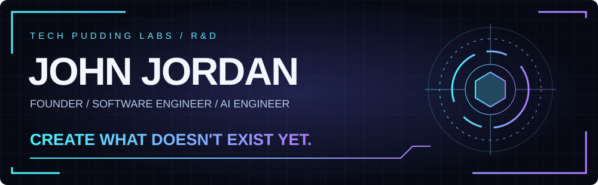
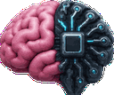

`01 // THE HUMAN BEHIND THE CODE`

<h2> About Me</h2>

I'm a technology founder, software engineer, and AI engineer exploring the intersection of artificial intelligence, computer science, and human creativity.

Through **Tech Pudding Labs**, I'm developing intelligent software, autonomous AI architectures, and experimental technologies that explore new ways of solving problems, discovering knowledge, and creating value.

I'm particularly interested in moving beyond conventional AI applications toward systems capable of autonomous research, structured reasoning, knowledge acquisition, and meaningful discovery.

I believe we're entering an extraordinary era of human-AI collaboration, and I want to be an active participant in building that future.

`02 // ACTIVE DEVELOPMENT`

<h2> Engineering What's Next</h2>

<table>
<tr>
<td width="50%" valign="top">

`PROJECT / 001`

### 🤖 Autonomous AI Engine

Developing an extensible AI architecture for autonomous research, knowledge acquisition, reasoning, memory, and intelligent task execution.

**Focus:** Autonomous Agents · RAG · Memory · Reasoning

</td>
<td width="50%" valign="top">

`PROJECT / 002`

### 🏔️ Metal Mountain

Applying AI-driven research, knowledge engineering, and automation to real-world industrial challenges.

A practical proving ground for intelligent systems and applied AI architecture.

**Focus:** Applied AI · Knowledge Engineering · Automation

</td>
</tr>
<tr>
<td width="50%" valign="top">

`PROJECT / 003`

### 🔬 Discovery Lab

Exploring AI-assisted scientific discovery, computational simulations, experimentation, and knowledge generation.

**Focus:** Research · Simulation · Computational Science

</td>
<td width="50%" valign="top">

`PROJECT / 004`

### 🧪 Tech Pudding Labs

Building a technology company dedicated to intelligent software, experimental engineering, and emerging technologies.

**Focus:** Software · AI · Research & Development

[Explore Tech Pudding Labs](https://techpuddinglabs.ai)

</td>
</tr>
</table>

`03 // EXPLORING THE FRONTIER`

<h2> Research & Engineering Interests</h2>

- Autonomous AI systems and multi-agent architectures
- Machine reasoning and knowledge representation
- Human-AI collaborative software development
- Computational engineering and applied mathematics
- Computational science and numerical simulations
- Machine learning and model optimization
- Local language models and intelligent infrastructure
- AI security, evaluation, and reliability
- AI-assisted scientific discovery

`04 // THE ENGINEERING TOOLKIT`

## ⌨️ Built With Code

### Programming Languages & Web Technologies

### Software Engineering

### Artificial Intelligence

### Development Tools

`05 // THE MISSION`

## Create What Doesn't Exist Yet.

To create meaningful technology that expands human knowledge, empowers people, and explores what's possible when human creativity and artificial intelligence work together.

Equally important is enjoying the journey — writing code, experimenting with ideas, embracing challenges, discovering new possibilities, and experiencing the joy of creating something that didn't exist before.

**The journey of creating is just as meaningful as what we ultimately build.**

<code>06 // HUMAN CONNECTION</code>

<h2 align="center">
 Connect With Me
</h2>

Let's connect to discuss artificial intelligence, software engineering, emerging technologies, research, and collaboration opportunities.

<h3 align="center">STAY CURIOUS. BUILD BOLDLY. ENJOY THE JOURNEY.</h3>

<code>HUMAN CREATIVITY × ARTIFICIAL INTELLIGENCE</code>

